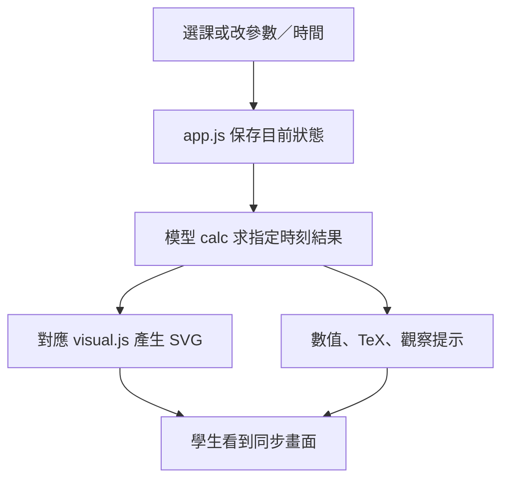

# Physics in Motion 詳細接手手冊

基準：2026-10-16，完成第六課後。網頁以英文為主；維護、操作及交接文件以中文為主。

先讀 [零程式底技術導讀](TECHNICAL_GUIDE_ZH.md)，再按工作種類查本文件。不懂程式的同事可以負責教材與教學驗收；修改模型及正式提交由維護者完成。

## 1. 接手後先確認甚麼

- [公開學生網站](https://xiaoyh-code.github.io/physics-in-motion/)
- [GitHub 原始碼](https://github.com/xiaoyh-code/physics-in-motion)
- 主要入口：`index.html`；年度導讀：`course-overview.html`。
- 本機原工作位置：`PHYS_SHC_EXP/term1_visuals/interactive/`。GitHub repository 根目錄對應這個 `interactive/` 資料夾，不包含整個原 workspace。
- 現有 16 課、16 個引言、55 個原創試題分題。頭六課是新版視覺推導，第 4–6 課預設收起計算；第 1–3 課尚未統一此預設。
- 第 7–16 課已有基本 SVG 互動模型，後續工作是升級，而不是從空白開始。
- 全站定位是選定的力學與能量課程及部分 IAL 延伸；年度課程圖不是完整 IAL 認證或教學完成證明。

### 課堂與網址 ID

網址 `index.html#momentum` 的 `momentum` 是程式辨識課堂的固定 ID。改標題可以，改 ID 會影響資料與連結，應避免。

| 課 | ID | 英文標題 | 目前版本 |
| --- | --- | --- | --- |
| 1 | `motion` | Velocity & time | 新版五視圖 |
| 2 | `displacement` | Displacement & SUVAT | 新版五視圖 |
| 3 | `projectile` | Projectile motion | 新版五視圖 |
| 4 | `vectors` | Resolve & combine forces | 新版、直接拖 A／B／R、計算收起 |
| 5 | `newton` | Drag & terminal velocity | 新版、開傘、概念為主、解釋收起 |
| 6 | `momentum` | One-dimensional collision | 新版、兩車、動量推導收起 |
| 7 | `momentum2d` | Two-dimensional collision | 基本互動版 |
| 8 | `impulse` | Impulse & impact time | 基本互動版 |
| 9 | `kinetic` | Kinetic energy & momentum | 基本互動版 |
| 10 | `moments` | Moments & equilibrium | 基本互動版 |
| 11 | `beam` | Loads & support reactions | 基本互動版 |
| 12 | `work` | Work & force direction | 基本互動版 |
| 13 | `energy` | Falling energy stores | 基本互動版 |
| 14 | `efficiency` | Efficiency & energy flow | 基本互動版 |
| 15 | `power` | Lifting & power | 基本互動版 |
| 16 | `elastic` | Elastic or inelastic? | 基本互動版，保留獨立彈性碰撞推導 |

## 2. 第一次在自己的電腦開啟

### 不用 Git 的方法

1. 到 repository 頁，選 **Code → Download ZIP**。
2. 解壓；保留整個資料夾，不能只取 `index.html`。
3. 確認電腦有 Python 3。沒有的話，請維護者協助安裝；學生只開公開網站，不用安裝。
4. 開 Terminal／終端機，輸入 `cd `，把解壓資料夾拖進終端機，再按 Enter。
5. 執行下列指令，再到瀏覽器開 `http://127.0.0.1:8000/`。

```sh
python3 -m http.server 8000 --bind 127.0.0.1
```

畫面應有 16 課，第一課顯示黑底互動場景。本機教師版課尾應有 Add your PDF or images。終端機要保持開啟，Ctrl+C 才會停服務。如顯示 port 已被使用，改成 `8002`，並開 `http://127.0.0.1:8002/`；新 port 的教師上傳儲存區不同。

本手冊的終端機指令以 macOS／Linux 為準。Windows 同事可直接用公開網址上課；如需本機維護，請維護者先準備能執行 `python3` 的環境。部分 Windows 安裝只提供 `py` 或 `python`，但目前檢查／建置腳本會呼叫 `python3`，不能只替換啟動網站的那一行便假設整套流程相容。

### 維護者用 Git 的方法

Git 是修改紀錄工具；clone 是第一次下載，pull 是取回之後更新。先避免多人同時直接修改同一份資料夾。

```sh
git clone https://github.com/xiaoyh-code/physics-in-motion.git
cd physics-in-motion
python3 -m http.server 8000 --bind 127.0.0.1
```

閱讀、上課不需要寫入 GitHub 的權限；提交修改需要 repository 擁有人授權的 GitHub 帳戶。不要把登入 token 寫入程式或文件。

## 3. 資料夾與程式責任

| 檔案／資料夾 | 責任 | 常見修改 |
| --- | --- | --- |
| `index.html` | 主頁骨架及腳本載入次序 | 新增互動模組入口、cache 版本。 |
| `app.js` | 選課、參數、播放、時間、公式、推導、試題、實驗 log | 共用行為；修改要回歸測試其他課。 |
| `models.js` | 原始 15 模型、參數範圍、輸出欄及計算 | 第 7–16 課多數仍使用這裡。 |
| `projectile.js` | 插入第 3 課解析模型 | 飛行時間、落地邊界、拋體計算。 |
| `terminal-model.js` | 替換第 5 課模型 | 數值下降路徑、三秒開傘。 |
| `collision-model.js` | 替換第 6 課模型 | 真正接觸時間、黏合／彈開與無碰撞。 |
| `motion-visual.js`、`displacement-visual.js`、`projectile-visual.js`、`forces-visual.js`、`terminal-visual.js`、`collision-visual.js` | 六課 SVG 圖形及視覺推導 | 車、傘、圖線、箭嘴、公式位置。 |
| `force-drag-model.js`、`forces-interaction.js` | 力的正解／逆解、滑鼠、觸控、鍵盤和數值控制 | 拖動邊界、固定哪個力、零合力。 |
| `terminal-lesson.js`、`collision-lesson.js` | 自訂控制器、閱讀提示及收起／展開 | 對應課的參數介面及觀察按鈕。 |
| `lab-features.js` | 新版繪圖分流、事件跳轉、四組比較、共用尺度 | 把新課接入互動功能。 |
| `motion-lesson.js`、`motion-lesson.css` | 首六課五視圖、preset 與外觀 | 分步標題、實驗個案、預設顯示。 |
| `visual-math.js` | 將 KaTeX 排版放入 SVG | 真 TeX、量度公式寬度、避免裁切。 |
| `style.css`、`visual-type.css` | 全站排版、手機介面、Arial | 不要強制覆蓋 KaTeX 數學字型。 |
| `content.js`、`opening-content.js` | 假設、推導、概念題、練習、答案與評分點 | 英文教學文字、公式、題目數值。 |
| `lesson-introductions-data.js`、`lesson-introductions.js` | 動機、問題、三個目標、來源及呈現 | 每課引言。 |
| `lesson-resources-data.js` | 磁碟上的共用教材清單與教師模式設定 | 正式新增 PDF／圖片。 |
| `lesson-resources.js`、`lesson-resources.css` | 本機上傳、預覽、資源列表 | 教師資源功能。 |
| `resource-export.js` | 無額外套件的 ZIP／學生網站匯出 | 打包邏輯；內含路徑與重複檔案檢查。 |
| `course-overview.*`、`curriculum-map-data.js` | 年度導讀、原計劃、IAL 對照和缺項 | 更新學年或課程證據。 |
| `resources/motion/` | 第一課 PDF、PNG、Typst 原稿 | 工作紙和答案版本。 |
| `resources/curriculum/` | 原始 DOCX、閱讀 PDF、課程圖 SVG／PPTX／PDF | 年度教材。 |
| `vendor/katex/` | 已附上的數學排版庫及字型 | 一般不改；更新要整套驗證。 |
| `worked.js`、`worked-data.js`、`worked_media/` | 舊影片基礎設施與素材 | 首六課已停用播放器，勿誤當新版來源。 |
| `test_*.cjs` | 可自動執行的測試 | 檢查模型及繪圖規則。 |
| `scripts/`、`.github/workflows/pages.yml` | 檢查、打包及發佈 | 下文說明。 |

### 重要載入次序

`models.js` 建立 `Physics`，`projectile.js` 插入第十六個模型；`terminal-model.js`／`collision-model.js` 隨後替換舊模型。**這些模型必須早於 `app.js` 載入**，因為 app 開始時就取得 `calc`／`duration` 等函數。只改 `models.js` 內的舊 `newton` 或 `momentum`，不會改到瀏覽器使用的新版模型。

KaTeX 要早於 `visual-math.js`；各課 `*-visual.js` 要早於 `lab-features.js`。引言資料要早於引言呈現程式。新增檔案時不要任意將所有 script 按字母排序。

## 4. 一次操作在程式內怎樣流動



模型盡量以 SI 單位運算。角度控制項用度數，模型內轉弧度。首六課換參數會暫停，並保留當前時間／構圖進度；拋體若新飛行時間更短，會截到新落地時刻。第 7–16 課的舊控制器可能保持播放。切課重設參數；四組比較按課分開，重新載入頁面後不保留。

新版 renderer 使用共同介面：輸入參數、時間、結果、比較組、手機版旗標、視圖及是否顯示計算；輸出 SVG、viewBox 和無障礙描述。這使畫面不必自行另開一條播放時鐘。

### 六課的物理邊界

- **1／2：**恆定加速度；帶符號位移與路程分開；不能把重疊面積當成分開行過的路程。
- **3：**重力固定、不計空氣阻力；垂直向上為正；時間到第一次地面接觸為止，末速度是撞地前；沒有反彈。「發射點已在地面，初速度水平或向下」時，模型在釋放當刻便接觸地面，所以飛行時間可為零；由高處水平拋出仍有飛行時間。
- **4：**A／B 各不超過 100 N。拖 R 須固定其中一個力，否則逆解不唯一。拖曳時固定視角及座標換算，放手再重整；零合力沒有方向。X／Y 量以帶正負的一維量呈現。
- **5：**固定重力、靜止空氣、恆定質量；內部用速度相關阻力、RK4 小步積分、三秒平滑開傘及插值。係數不是學生計算要求。沒有地面或落傘安全設計。
- **6：**每車模型長 2 m，中心初始 −5／+5 m，保險桿距離 8 m。質量 0.5–5 kg，兩車初速度各 −8 至 +8 m/s；接觸時間由追近速度決定。六秒內未接觸便不碰撞。碰撞瞬時，位置連續；黏合或完全彈性為兩個選項，不模擬有限時間的撞擊力／變形。

教材範圍和參考來源見 [技術導讀第 7 節](TECHNICAL_GUIDE_ZH.md#7-學科與設計參考來源) 及 `LESSON_INTRO_SOURCES.md`。

## 5. 修改文字、公式或試題

### 改英文引言

在 `lesson-introductions-data.js` 找到課堂 ID，改 `why`、`question` 或三個 `outcomes`。保留引號、逗號、括號和 ID。不熟悉 JS 的同事，先交一份「原句 → 改句」，由維護者套入。

### 改公式與練習

正文數學用 `\(...\)`；獨立步驟的 `tex` 欄直接放 TeX。JS 原稿多用 `String.raw`，例如 ``String.raw`v=u+at` ``；不要把原稿內的反斜線誤刪，亦不要把 HTML 貼進純文字欄。

試題主要欄位：`context` 是情境，`parts` 是分題，`marks` 是分數，`answer` 是答案，`points` 是逐點評分，`numeric` 是可選數值檢查答案。改題目數值後必須重算答案；每個評分點對應一分。數值檢查接受約 1% 誤差，不會自動評方法、方向、單位或有效數字。

有同名內容可能在 `opening-content.js` 被覆寫；編輯前搜尋該 ID 在兩份檔案的位置。不要只改看似較早的那一份。第六課「Use question values in the lab」的參數在 `lab-features.js`，改試題時要同步。

## 6. 加入工作紙與分享教材

### A. 不改程式的本機試用

1. 開本機教師版，選課，在課尾 Add your PDF or images 選原檔。
2. 確認標題、預覽和頁面顯示，保留原始 PDF／圖片作備份。
3. 按 Export student website；若有示例教材選項，按教學需要決定是否保留。
4. 解壓到新資料夾，啟動本機伺服器，用另一個瀏覽器查看，確認教材隨網站而來。

這個匯出會包含瀏覽器 IndexedDB 上傳；不含學生答案／log，也不會自動推送 GitHub。支援 PDF、PNG、JPEG、WebP、GIF，每檔上限 30 MB。PDF 使用瀏覽器原生預覽；不會自動變成逐頁 PNG。

學生平日直接開公開網址即可，不需要 Python。離線拿到學生 ZIP 時，要先完整解壓，再雙擊 `index.html`；Chromium 已測得基本互動與 PNG 教材可用。`file://` 的儲存及內嵌 PDF 依瀏覽器而異，必要時直接開 PDF 原檔；完整本機驗收仍採第 2 節 HTTP server 流程。教師版的 Export student website 需要 HTTP server，不能在 `file://` 執行。

### B. 放到目前的 GitHub Pages

維護者將共享原檔放進 `resources/課堂名稱/`，再在 `lesson-resources-data.js` 對應 ID 的 `resources` 陣列登記。可參考現有 `motion-sample-qp`：保留唯一 `id`，填 `kind`、`title`、`description`、`pdf`；圖片預覽用 `pages` 的 `src`／`alt`。

如沒有逐頁圖片，可只登記 PDF；如有圖片，填清楚用途與替代文字。PDF／圖片可用英文檔名減少手動連結出錯。確認有適合公開的版本，再執行檢查、建置及提交。`resources/` 的媒體會自動納入 manifest；只加檔案而沒有登記，不會出現在課堂資源列表。

以下是兩個「陣列內的一項」格式例子；由維護者加入對應課堂，檔案亦須實際存在：

```js
{
  id: 'momentum-worksheet', kind: 'pdf',
  title: 'Collision worksheet',
  description: 'Read and practise after the experiment.',
  pdf: 'resources/momentum/collision-worksheet.pdf'
}
```

```js
{
  id: 'momentum-diagram', kind: 'image',
  title: 'Before and after contact',
  description: 'Compare the directions of motion.',
  src: 'resources/momentum/collision-diagram.png'
}
```

PDF 本體用 `pdf`；獨立圖片本體用 `src`；`pages` 是 PDF 額外的逐頁圖片預覽，不能代替圖片本體的 `src`。同一個陣列放多項時，項目之間要有逗號。

**不可只上傳到自己瀏覽器後按 Git push。** Git 只追蹤磁碟原稿；GitHub Actions 讀不到本機瀏覽器。現行公開建置只讀共用教材清單。目前第一課 QP／MS 是共同示例；其他課的新增原檔需按上述流程登記。

### C. 修改 Typst 工作紙

`resources/motion/` 有 QP（題目）及 MS（答案）的 `.typ` 原稿。安裝 Typst 的維護者可在該資料夾執行：

```sh
typst compile Lesson_01_Velocity_Time_QP.typ Lesson_01_Velocity_Time_QP.pdf
typst compile Lesson_01_Velocity_Time_MS.typ Lesson_01_Velocity_Time_MS.pdf
```

重新檢查兩份 PDF 和預覽圖片，避免改了 PDF 卻仍顯示舊 PNG。原稿使用指定的正文及中英文字型；換電腦重新編譯時，若中文字腳或符號缺字，先由維護者安裝相應字型或核對替代字型，再做逐頁目視檢查。`resources/motion/source/author_sample.py` 是早期生成器，重跑會重寫原稿；日常修改以 `.typ` 為準。更詳細頁面規格見該資料夾 README。

## 7. 年度課程圖與 Canva

`curriculum-map-data.js` 是網頁對照的資料來源；包含具體 IAL 條目、學校計劃證據、未涵蓋項目。更改課程判斷時要附來源，不能只把「有提過」改成「已完整涵蓋」。

`resources/curriculum/` 另有可編輯 SVG、獨立文字／圖形的 PPTX，以及閱讀用 PDF／PNG。Canva 設計是獨立副本，編輯 Canva 不會改到上述檔案或網頁。更新後應重新輸出、替換對應版本並核對。

原始年度 DOCX 保持逐位元相同；PDF 是調整少量排版的閱讀副本。原計劃下載是公開教材的一部分，包含原有文件 metadata；不要為了排版而覆寫原始 DOCX。Canva 入口仍受 Canva 帳戶權限控制，隱藏連結不是權限保護；同事需要編輯時向擁有人取得設計權限，切勿要求分享帳戶密碼。

## 8. 檢查、建置、正式發佈

### 一次性準備

維護電腦需要 Node.js 20+、Python 3。瀏覽網頁本身不需要它們。沒有 npm 套件安裝步驟。GitHub Actions 使用 Node.js 24 及 runner 的 Python 3。

### 每次改完

在 repository 根目錄執行：

```sh
node scripts/check_site.cjs
node scripts/build_public_site.cjs
python3 -m http.server 8001 --bind 127.0.0.1 --directory dist
```

第一步檢查 JS 語法、入口資源及 12 套測試；第二步建立公開學生版；第三步預覽 `http://127.0.0.1:8001/`。`dist/` 是生成結果，不是日常修改位置。建置會清除並重建它，亦產生 `artifacts/Physics_in_Motion_Student.zip`。

建置保留教師原稿的 teacher mode，只在 `dist/` 轉成 student mode；不會把上傳控制放到學生版。打包會驗證檔案清單、ZIP、路徑及原始年度計劃。公開內容仍有答案／評分點，學生模式不是登入防線。

### 提交與部署

1. 先用 `git diff` 查看實際改動；不要提交 `dist/`、瀏覽器紀錄、密鑰或暫存檔。
2. 將已審核的原稿加入 commit（一次可辨識的修改紀錄）。
3. 推送 main，或由同事開分支／PR，經審閱後合併 main。
4. 到 GitHub **Actions → Check and deploy GitHub Pages** 看結果。綠色成功才代表部署完成。
5. 開公開網址，檢查剛修改的課、公式及工作紙；學生版應沒有教師上傳按鈕。

維護者常用指令示例（先將檔名換成自己已核對的檔案）：

```sh
git status --short
git diff
git add content.js opening-content.js
git commit -m "Revise lesson content"
git push origin main
```

部署流程採 [GitHub 官方 Pages workflow](https://docs.github.com/en/pages/getting-started-with-github-pages/using-custom-workflows-with-github-pages)：先檢查，再建立學生版，最後只把 `dist/` 作為網站 artifact 發佈。repository 首次需在 Settings → Pages 選 GitHub Actions；本次初始發佈會完成設定。日後正常更新毋須每次重設。

### 舊 Lesson ZIP 腳本

`scripts/package_lesson2.cjs` 至 `package_lesson6.cjs` 是原 workspace 的里程碑封存工具。它們會在相對上兩層位置輸出舊命名 ZIP，並重建對應 QA extraction；不適合作為新同事的日常建置入口。新的共用入口是 `build_public_site.cjs`。不要開著 extraction 資料夾的 server 再重跑會刪除該 extraction 的舊腳本。

## 9. 如何延續升級第七課

先與任課教師決定：觀察甚麼、學生已懂甚麼、哪些數學先不展示、模型假設及需要處理的極端情況。保留 `momentum2d` ID。

1. 定義兩方向的動量守恆、正方向、碰撞時刻與模型限制；不要為配合畫面而違反模型。
2. 如需新模型，新增純計算檔並在 app 之前載入；同時補 outputs。
3. 建立對應 `*-visual.js`，使用共同 renderer 介面、Arial、真 TeX、共用時間及等軸尺度。
4. 在 `lab-features.js` 加 supported set、黑底 class 名單、renderer 分流、事件與比較方式。
5. 在 `motion-lesson.js` 加五視圖、三個 preset、stage 狀態及英文文案。
6. 若要預設收起，建立只影響該課的 controller／CSS，接好 `renderControls` 和 `onUpdate`；避免其他課被隱藏或標題被覆寫。
7. 同步引言、假設、推導、概念題、試題與「Use question values」參數。
8. 核對 `worked.js` 的影片排除、`lesson-resources.js` route、`app.js` 參數保留時間名單；加入 index 並更新 cache query。
9. 驗證模型守恆、零值／反向／特殊情況、SVG／TeX、手機觸控、鍵盤、切課及四組比較；再回歸首六課。
10. 更新文件和 manifest，建立學生版，預覽通過後提交發佈。

共用標準：保留既有外觀，先觀察再推導，普通文字 Arial、公式 TeX，不新增播放器；圖與讀數來自同一 state。要改既有教學預設，先讓任課教師看到具體效果。

## 10. 驗收、疑難排解及限制

### 人手驗收

- 桌面及 375／320 px 手機，沒有橫向溢出或公式被裁切。
- Play／Pause／Reset、步進、速度、時間軸及事件跳轉都能用。
- 改參數保留合適時間；各方向、零值和沒有事件的情況合理。
- 推導展開／收起不會改變參數；切課不會留下其他課的控件。
- PDF、圖片、答案與題目相符；來源連結可開。
- 保留四組比較後尺度一致；色彩之外還有標籤／線型可分辨。

| 問題 | 先檢查 |
| --- | --- |
| 公式不見或亂碼 | `vendor/katex/` 字型齊否、TeX 是否被誤改、Console 有沒有錯。 |
| 本機有新圖，上線沒有 | 檔案有否提交、manifest 是否重建、Actions 是否成功、是否改錯 dist。 |
| 新模型改完沒有反應 | 是否只改到被替換的 models.js 舊條目、index 次序與 cache 是否正確。 |
| 換電腦後上傳不見 | IndexedDB 按瀏覽器與 origin 分開；從原機匯出或找原檔。 |
| PDF 已更新但預覽仍舊 | 逐頁 PNG 和 cache query 是否一起更新。 |
| 網頁仍舊版本 | 核對 Actions 的 commit、重新載入；必要時更新受影響資源的版本 query。 |
| Actions 失敗 | 先看第一個紅色步驟；是語法／模型測試、建置漏檔，還是 Pages 設定。不要跳過失敗測試直接上線。 |

自動測試不能取代老師的教學判斷或真正觸控操作。`test_models.cjs` 主要檢查原始 15 模型，不能單獨代表新增模型正確；新 terminal／collision 測試另有實際注入檢查。歷史測試數量見各課 `LESSON*_VERIFICATION.md`；本次總檢查見 `REVIEW_RECORD_ZH.md`。

## 11. 最小交接清單

交付 repository 連結、公開網址及本文件；另保留教師工作紙原檔、Typst 原稿、Canva 存取權、年度計劃原檔及教師瀏覽器匯出的學生 ZIP。清楚告知同事哪些課已升級、哪些教材只在本機。

不要將舊 ZIP、程式原稿、公開網站和 Canva 視為自動互相同步的同一份檔案。每次交接應指定 repository 的 commit，及對應成功部署的 Actions 紀錄，作為共同版本基準。
